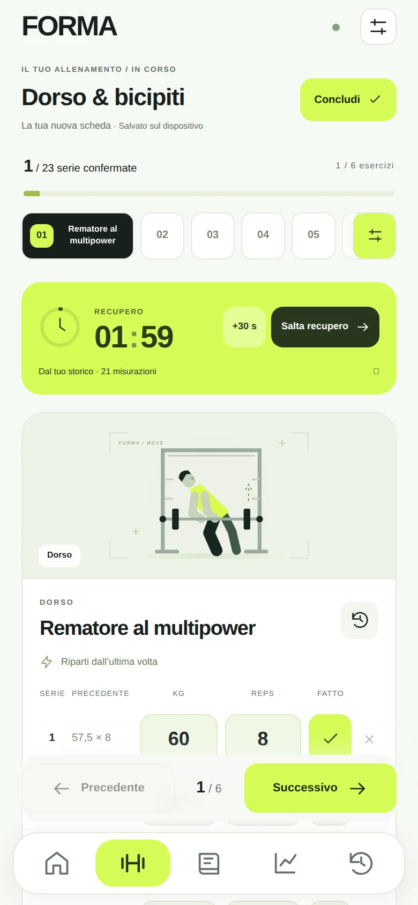
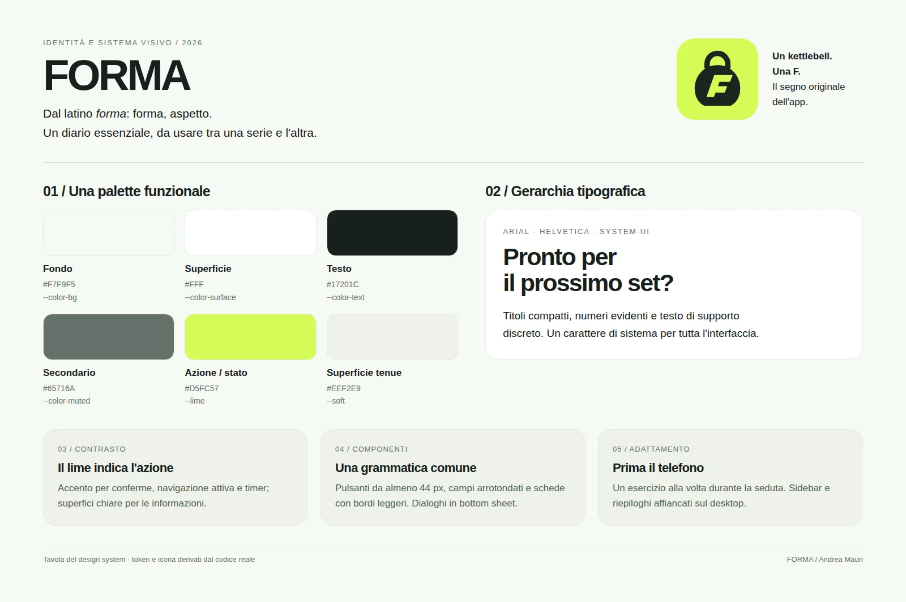

<p align="center">
  
</p>

<h1 align="center">FORMA — Diario personale di allenamento</h1>

<p align="center">Il tuo allenamento, serie dopo serie.</p>

<p align="center">
  
  
  
  
  
  
</p>

<p align="center">
  <a href="https://fitness.andrea-mauri.duckdns.org/">Applicazione online</a> ·
  <a href="https://portfolio.andrea-mauri.duckdns.org/projects/forma">Il progetto nel portfolio</a> ·
  <a href="docs/TECHNICAL.md">Documentazione tecnica</a>
</p>


## 📖 Panoramica

**FORMA** è una Progressive Web App per registrare gli allenamenti in palestra: ritrovare i pesi della seduta precedente, confermare le serie svolte e gestire i recuperi, anche quando la connessione manca.

L'ho costruita per un'esigenza personale e affinata usandola durante le mie sessioni. Lo sviluppo, tra marzo e settembre 2026, ha attraversato versioni successive, interruzioni e prove sul campo. La perdita di vecchi backup mi ha portato a dare più spazio alla continuità dei dati, con salvataggio sul dispositivo e sincronizzazione con il server.

Il telefono è il punto di partenza; il desktop offre una disposizione dedicata per consultare programma e progressi con più spazio. Le immagini di questo README mostrano la vera applicazione con **dati sintetici**.

## ✨ Funzionalità principali

- **Una serie alla volta:** carico precedente accanto al valore attuale, conferma esplicita e navigazione libera tra gli esercizi. Un peso suggerito non conta come serie eseguita.
- **Recupero regolabile:** timer avviato alla conferma, incremento di 30 secondi e scadenza conservata dopo il ricaricamento.
- **Schede modificabili:** creazione, duplicazione, attivazione e sostituzione degli esercizi. Le sedute già iniziate conservano una copia del programma originale.
- **Diario e progressi:** storico per esercizio, volume e confronto dei carichi filtrabile per ripetizioni.
- **Continuità offline:** scrittura immediata in IndexedDB, coda delle modifiche e sincronizzazione con Express/SQLite quando il server torna disponibile.
- **Backup e PWA:** esportazione e importazione con validazione, installazione sulla schermata Home e avviso prima di aggiornare l'app.

<p align="center">
  
</p>

## 🎨 Nome e design system

**FORMA**, dal latino *forma*: forma, aspetto. L'icona unisce un kettlebell alla lettera F. Il sistema visivo usa superfici chiare, testo scuro e un accento lime per azioni e stati, con tipografia Arial e componenti coerenti tra telefono e desktop.

| Ruolo | Colore |
| :--- | :--- |
| Fondo | `#F7F9F5` |
| Superfici | `#FFFFFF` |
| Testo | `#17201C` |
| Testo secondario | `#65716A` |
| Azioni e stato attivo | `#D5FC57` |
| Superfici tenui | `#EEF2E9` |



## 🛠️ Architettura

| Layer | Tecnologie e responsabilità |
| :--- | :--- |
| Frontend | React 18, TypeScript, Vite, React Router, TanStack Query |
| Interfaccia | CSS, Tailwind CSS, illustrazioni SVG locali, bottom sheet nativi |
| Dati sul dispositivo | IndexedDB, snapshot delle schede e outbox transazionale |
| API e persistenza | Node.js, Express, SQLite con better-sqlite3 |
| PWA | Service worker, cache dell'interfaccia e aggiornamento su richiesta |
| Distribuzione e verifiche | Docker Compose, Nginx, Playwright e test Node.js |

Ogni modifica salva dati locali e operazione da inviare nella stessa transazione. L'outbox conserva l'ultima operazione per elemento; le cancellazioni si propagano attraverso tombstone. In caso di conflitto prevale la versione più recente della **seduta intera**: il sistema è pensato per un diario personale, non per modificare contemporaneamente la stessa seduta su dispositivi diversi.

La mappa del recupero rappresenta l'esposizione muscolare recente secondo un modello di visualizzazione. Non misura il recupero fisiologico e non fornisce indicazioni mediche.

## 📂 Struttura del repository

```text
FORMA/
├── src/app/
│   ├── routes/          # Panoramica, seduta, schede, diario, progressi e preferenze
│   ├── components/      # Layout, bottom sheet, timer e illustrazioni
│   └── lib/             # IndexedDB, sincronizzazione, carichi e recupero
├── public/              # Icone, manifest e programmi iniziali
├── server/              # API Express, persistenza SQLite e migrazioni
├── tests/               # Test unitari, API e browser
├── scripts/             # Supporto ai test della PWA
├── docs/                # Dettagli tecnici, roadmap e anteprime
└── docker-compose.yml   # Frontend, API e visualizzatore SQLite
```

## 🚀 Avvio locale

Richiede **Node.js 20.19+ oppure 22.12+**, npm e Chromium per i test browser.

```bash
git clone https://github.com/Payd3r/FORMA.git
cd FORMA
npm ci
npm ci --prefix server
cp .env.example .env
```

Avvia l'API dalla radice, indicando esplicitamente il database locale:

```bash
DB_PATH="$PWD/server/data/fitness.db" npm run dev --prefix server
```

In un secondo terminale:

```bash
npm run dev
```

Il frontend risponde su `http://localhost:5173` e inoltra `/api` al backend sulla porta `3001`. Il database viene creato automaticamente se assente. La configurazione `.env` è letta da Vite e Docker Compose; per avviare il backend fuori da Docker, passare le sue variabili al processo come nell'esempio.

| Variabile | Utilizzo |
| :--- | :--- |
| `VITE_API_URL` | Override facoltativo dell'URL API del frontend |
| `FITNESS_DEV_API_TARGET` | Destinazione del solo proxy Vite di sviluppo |
| `DB_PATH` | Percorso SQLite del backend; impostarlo esplicitamente |
| `PORT` | Porta del backend, predefinita `3001` |
| `SERVICE_API_TOKEN` | Token facoltativo per le sole route service-to-service |

L'installazione è **personale e senza login**. Le normali API del diario non sono protette dal token service-to-service: l'accesso va gestito attraverso rete e reverse proxy. Per provare il codice usa una tua installazione locale; il sito collegato è l'istanza personale.

## 🐳 Distribuzione

Il Compose incluso usa una rete esterna `web-proxy` e conserva SQLite in `server/data`. Richiede un reverse proxy predisposto per servire il frontend in HTTPS; Nginx inoltra le richieste API al backend.

```bash
# Solo se la rete non esiste già
docker network create web-proxy

# Build e avvio dei due servizi applicativi
docker compose build fitness-web fitness-api
docker compose up -d fitness-web fitness-api
```

Per abilitare le route service-to-service, imposta un tuo `SERVICE_API_TOKEN` nel file `.env`, escluso da Git. Il servizio `sqlite-web` è uno strumento facoltativo di amministrazione, da avviare soltanto in una rete protetta. Conserva il volume dati e i backup durante gli aggiornamenti.

## ✅ Verifiche

```bash
npm run typecheck
npm run lint
npm test
npx playwright install chromium
npm run test:e2e
```

I test browser usano un database separato in `/tmp/forma-playwright.db`. Coprono, tra gli altri, conferma delle serie, snapshot delle schede, offline, sincronizzazione tra dispositivi, import/export e aggiornamento del service worker. Dettagli e limiti del modello dati sono in [docs/TECHNICAL.md](docs/TECHNICAL.md); la roadmap è in [docs/ROADMAP-FORMA.md](docs/ROADMAP-FORMA.md).

## 👤 Autore

Realizzato interamente da **Andrea Mauri** — [@Payd3r](https://github.com/Payd3r). Ho usato GPT 6.1 con effort light esclusivamente come supporto alla parte grafica; nell'app non sono integrati servizi AI.
